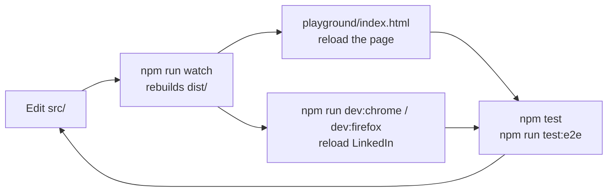

# Development

## Requirements

- **Node.js 22 or newer** (see `.nvmrc`; `nvm use` picks it up).
- **Google Chrome** (or Chromium) and/or **Firefox** for running the extension
  and the end-to-end tests.
- Optional: **ImageMagick 7** (`magick`), only to regenerate the icons.

The extension has **no runtime dependencies**. Development dependencies are
kept to the minimum:

| Package                           | Used for                                             |
| --------------------------------- | ---------------------------------------------------- |
| `esbuild`                         | bundling `src/content/` into one `content.js`        |
| `web-ext`                         | running, linting and zipping the extension (Mozilla) |
| `eslint`, `@eslint/js`, `globals` | linting                                              |

Tests use Node's built-in test runner, and the end-to-end tests talk to the
browsers with Node's built-in WebSocket: no test framework, no Puppeteer, no
Playwright.

## Setup

```sh
git clone https://github.com/napolux/linkedin-fonts.git
cd linkedin-fonts
npm install
npm run build
```

## Commands

| Command                 | What it does                                                                  |
| ----------------------- | ----------------------------------------------------------------------------- |
| `npm run build`         | Builds `dist/chrome/` and `dist/firefox/` (minified).                         |
| `npm run build:chrome`  | Builds only `dist/chrome/`.                                                   |
| `npm run build:firefox` | Builds only `dist/firefox/`.                                                  |
| `npm run watch`         | Rebuilds both on every change (not minified, with inline source maps).        |
| `npm run dev:chrome`    | Starts Chrome with `dist/chrome` loaded and opens LinkedIn.                   |
| `npm run dev:firefox`   | Starts Firefox with `dist/firefox` loaded and opens LinkedIn (auto-reloads).  |
| `npm test`              | Unit tests (`test/*.test.js`).                                                |
| `npm run test:e2e`      | Builds, then runs the end-to-end tests in headless Chrome and Firefox.        |
| `npm run lint`          | ESLint, then `web-ext lint` on `dist/firefox` (run a build first).            |
| `npm run package`       | Builds and zips both browsers into `artifacts/`.                              |
| `npm run package:source`| Zips the committed sources (for addons.mozilla.org review).                   |

A typical loop is `npm run watch` in one terminal and `npm run dev:firefox`
(or `dev:chrome`) in another. `web-ext` reloads the extension when `dist/`
changes. Reload the LinkedIn tab to pick up the new content script.

`dev:chrome` and `dev:firefox` start a **fresh browser profile**, so you
need to log in to LinkedIn there. To use your everyday profile instead, load
the extension manually.

## Load the extension in your browser

### Chrome (and Edge, Brave, other Chromium browsers)

1. `npm run build:chrome`
2. Open `chrome://extensions` and enable **Developer mode** (top right).
3. Click **Load unpacked** and pick the `dist/chrome` folder.
4. After rebuilding, click the reload icon on the extension card and reload the LinkedIn tab.

### Firefox

1. `npm run build:firefox`
2. Open `about:debugging#/runtime/this-firefox`.
3. Click **Load Temporary Add-on…** and pick `dist/firefox/manifest.json`.
4. The add-on stays until Firefox restarts. **Reload** on the same page picks up rebuilds.

## Project structure

| Path                         | Contents                                                       |
| ---------------------------- | -------------------------------------------------------------- |
| `src/content/`               | The content script (see [architecture.md](architecture.md)).   |
| `src/manifest/`              | `base.json` plus the per-browser overrides.                    |
| `src/icons/`                 | `icon.svg` (source) and the generated PNGs.                    |
| `scripts/build.mjs`          | The build: one source tree, one output per browser.            |
| `scripts/lib/manifest.mjs`   | Manifest merging.                                              |
| `scripts/package-source.mjs` | Source archive for the addons.mozilla.org review.              |
| `scripts/icons.sh`           | Regenerates the PNG icons from the SVG.                        |
| `test/*.test.js`             | Unit tests (Node test runner).                                 |
| `test/e2e/`                  | End-to-end tests and the tiny CDP / WebDriver BiDi drivers.    |
| `playground/index.html`      | Local test page with LinkedIn-like fields.                     |
| `DOCS/`                      | This documentation.                                            |
| `dist/`, `artifacts/`        | Build output (git-ignored).                                    |

The development loop:



## The playground

`playground/index.html` mimics LinkedIn's fields: a multi-paragraph
contenteditable with a mention chip, a textarea, a text input, a search box
and static text, plus a "Start a post" and an "Edit intro" **modal dialog** and
a chat **popover** (LinkedIn's editors in the browser's top layer). It loads `../dist/chrome/content.js` with a plain `<script>`
tag (the content script uses no extension APIs), so **no extension install is
needed**:

1. `npm run build:chrome` (or keep `npm run watch` running).
2. Open `playground/index.html` in any browser.
3. Select text and play. Under each field the real code points are shown
   (e.g. `U+1D5DB`), and a button switches light/dark mode.

The playground is also what the end-to-end tests drive.

## Tests

### Unit tests: `npm test`

- `test/unicode.test.js`: every styling rule (combinations, accents, digits,
  underline, serif decoding, non-Latin text, emoji).
- `test/diff.test.js`: minimal edits, surrogate pairs.
- `test/manifest.test.js`: manifest merging and the shipped manifests (MV3,
  LinkedIn-only matches, no permissions, Firefox data-collection declaration).

### End-to-end tests: `npm run test:e2e`

`test/e2e/playground.e2e.mjs` starts **headless Chrome and Firefox**, opens the
playground and acts like a user: it selects text, clicks the toolbar buttons
with real mouse events and presses real keyboard shortcuts. It then checks
the field contents, the selection, the toolbar's visibility and position, and
undo. Screenshots in light and dark mode are written to `artifacts/e2e/` for
visual review.

- Browsers are looked up in the standard install locations. Set
  `CHROME_PATH` / `FIREFOX_PATH` to use others. A browser that is not found
  is skipped.
- Shortcuts use <kbd>⌘</kbd> on macOS hosts and <kbd>Ctrl</kbd> elsewhere, as a
  real user would. A test also presses the *other* modifier (<kbd>Ctrl</kbd> on
  macOS) and checks that it is ignored and reaches the page untouched.
- The toolbar lives in a closed shadow root, so the tests find it by probing
  the viewport with `document.elementFromPoint`, and click its buttons by
  coordinates.

### Manual checklist on linkedin.com

Automated tests cannot log in to LinkedIn. Before a release, check by hand in
**both** browsers:

- [ ] New post: select a word, then B, I, U, and B again (removes bold). The toolbar stays open.
- [ ] Post with several paragraphs, a mention and a hashtag: underline across them.
- [ ] Comment and reply boxes.
- [ ] Messaging (full page and the chat overlay).
- [ ] Profile: headline (input) and About (textarea).
- [ ] Keyboard shortcuts in each of the above (<kbd>⌘</kbd> on macOS, <kbd>Ctrl</kbd> elsewhere). On macOS, <kbd>Ctrl</kbd>+<kbd>B</kbd>/<kbd>I</kbd>/<kbd>U</kbd> must do nothing. Outside LinkedIn fields the shortcuts must keep their usual browser behaviour.
- [ ] Undo (<kbd>⌘</kbd>+<kbd>Z</kbd> / <kbd>Ctrl</kbd>+<kbd>Z</kbd>) after a change.
- [ ] LinkedIn's dark mode (*Settings → Preferences → Dark mode*): the toolbar turns dark.
- [ ] Publish a post and check that the text looks right in the feed.

## Debugging

- **Console**: the content script logs to the page's DevTools console. In
  Chrome, choose the extension's context in the console's context drop-down.
  In Firefox, content script messages appear in the page console.
- **Readable code**: use `npm run watch`, whose builds are not minified and
  have inline source maps, so DevTools shows the original files.
- **Toolbar DOM**: DevTools shows closed shadow roots. Look for
  `<linkedin-fonts-toolbar>` at the end of `<html>`.
- **What did the extension write?** In the console,
  `[...$0.textContent].map(c => c.codePointAt(0).toString(16))` on the
  selected element lists the code points.

## Icons

`src/icons/icon.svg` is the source. Its glyphs are paths, so rendering does
not depend on installed fonts. After editing it, run:

```sh
./scripts/icons.sh   # needs ImageMagick 7
```

and commit the regenerated PNGs. Builds only copy the PNGs.

## Code style

- Vanilla JavaScript (ES2023+) and CSS. **No runtime dependencies.**
- English everywhere: code, comments, docs, commit messages.
- JSDoc on exported functions; comments explain *why*, not *what*.
- Keep `unicode.js` and `diff.js` free of DOM access so they stay unit-testable.
- `npm run lint` and `npm test` must pass. See [CONTRIBUTING.md](../CONTRIBUTING.md).
