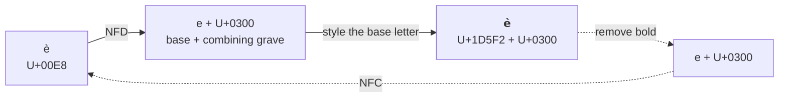

# Unicode mapping

LinkedIn stores plain text only. To show bold or italic text, the extension
replaces letters with look-alike characters from the **Mathematical
Alphanumeric Symbols** block (U+1D400–U+1D7FF). These are real, distinct
characters that every reader sees, whatever their device. Underline is done
differently: the **COMBINING LOW LINE** (U+0332) is appended to each
character.

All of this lives in [`src/content/unicode.js`](../src/content/unicode.js) and is
covered by [`test/unicode.test.js`](../test/unicode.test.js).

## Characters written by the extension (sans-serif)

The extension always **writes** the sans-serif variants, because they blend
with LinkedIn's sans-serif UI font.

| Style       | A–Z start | a–z start | 0–9 start | Example                |
| ----------- | --------- | --------- | --------- | ---------------------- |
| Bold        | U+1D5D4   | U+1D5EE   | U+1D7EC   | 𝗛𝗲𝗹𝗹𝗼 𝟮𝟬𝟮𝟲           |
| Italic      | U+1D608   | U+1D622   | n/a       | 𝘏𝘦𝘭𝘭𝘰 2026            |
| Bold italic | U+1D63C   | U+1D656   | U+1D7EC (bold) | 𝙃𝙚𝙡𝙡𝙤 𝟮𝟬𝟮𝟲      |

Each range is contiguous: `B` is `start + 1`, `C` is `start + 2`, and so on.

**Digits** only exist in bold, because Unicode has no italic digits. So:

- italic never changes digits, and `analyze()` ignores them for italic;
- bold italic digits are written as bold digits.

## Characters also recognised (serif)

Text styled by other tools often uses the serif variants. The extension
**reads** them as well, so it can detect their style and remove it:

| Style       | A–Z start | a–z start | 0–9 start | Example        |
| ----------- | --------- | --------- | --------- | -------------- |
| Bold        | U+1D400   | U+1D41A   | U+1D7CE   | 𝐇𝐞𝐥𝐥𝐨 𝟐𝟎      |
| Italic      | U+1D434   | U+1D44E   | n/a       | 𝐻𝑒𝑙𝑙𝑜          |
| Bold italic | U+1D468   | U+1D482   | n/a       | 𝑯𝒆𝒍𝒍𝒐          |

The serif italic range has one **hole**: small *h* (U+1D455) is reserved,
because the character already existed as U+210E PLANCK CONSTANT (ℎ), which is
used instead. Holes like this exist because some letters were already in
Unicode before the block was created. The sans-serif ranges have none.

When a recognised serif character is restyled (for example, italic is added
to serif bold), the result is written in sans-serif.

## Underline: U+0332

Underline appends U+0332 COMBINING LOW LINE after each character:
`a b` → `a̲ ̲b̲`. Spaces are underlined too, so the line is continuous.

Not underlined:

- line breaks (`\n`, `\r\n`, U+2028, U+2029…);
- emoji shown as pictures (`Emoji_Presentation`, sequences with U+FE0F,
  flags). A combining line under an emoji renders badly.

When deciding whether a selection *is* underlined, whitespace is ignored
(unless the selection is only whitespace), so `a̲ b̲` counts as underlined.

Underline combines freely with bold and italic: `𝗮̲`.

## Accented letters

Precomposed letters such as `è` (U+00E8) have no Mathematical counterpart.
The extension **decomposes** each grapheme (Unicode NFD), styles the base
letter and keeps the accent as a combining mark (solid arrows below).

The output of each changed grapheme is normalized to **NFC**. When a style is
removed, `e + U+0300` recombines into the original precomposed `è` (dashed
arrows), so the round trip is exact:



The same applies to whole sentences:

| Text                | After bold       | After removing bold |
| ------------------- | ---------------- | ------------------- |
| Perché è così?      | 𝗣𝗲𝗿𝗰𝗵𝗲́ 𝗲̀ 𝗰𝗼𝘀𝗶̀?  | Perché è così?      |

This covers most Western European letters: à á â ã ä å ç è é ê ë ì í î ï ñ
ò ó ô õ ö ù ú û ü ý ÿ and their capitals, plus many Central European ones
(č, ř, š, ž, ą, ę, ő, ű…).

Accent placement depends on the font, so some devices draw combining accents
slightly offset from the styled letter.

## What is not changed

Bold and italic only apply to:

- `A–Z`, `a–z` (and accented letters that decompose to them);
- `0–9` (bold only).

Everything else keeps its exact original code points:

- letters without a decomposition: `ß ø æ œ ł đ þ ı`…;
- other scripts: Greek, Cyrillic, Arabic, Hebrew, CJK…;
- punctuation, symbols, emoji.

Graphemes the operation does not affect are copied **unchanged**, without
even being normalized. Only characters that actually change are rewritten.

## Grapheme model

Each grapheme (from `Intl.Segmenter`) is parsed into:

```js
{
  base,       // 'A'…'z' or '0'…'9', or null if not stylable
  bold,       // boolean
  italic,     // boolean
  underline,  // true if U+0332 is among its marks
  marks,      // other combining marks (accents), kept as they are
}
```

and rendered back as `style(base) + marks + (underline ? U+0332 : '')`, then
NFC-normalized. Orphan combining marks (a selection that starts right after a
base letter) are kept as they are.

## References

- [Unicode chart: Mathematical Alphanumeric Symbols (PDF)](https://www.unicode.org/charts/PDF/U1D400.pdf)
- [Unicode chart: Combining Diacritical Marks (PDF)](https://www.unicode.org/charts/PDF/U0300.pdf)
- [UAX #15: Unicode Normalization Forms](https://www.unicode.org/reports/tr15/)
- [UAX #29: Text Segmentation (graphemes)](https://www.unicode.org/reports/tr29/)
