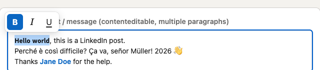
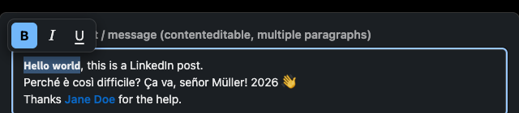

# Fonts for LinkedIn

[](https://github.com/napolux/linkedin-fonts/actions/workflows/ci.yml)
[](LICENSE)

A tiny browser extension for **Chrome** and **Firefox** that adds **Bold**, *Italic* and
<u>Underline</u> to LinkedIn posts, comments, messages and profile fields.

Select some text in any LinkedIn text field and a small toolbar appears, in
light or dark mode to match LinkedIn:

| Light mode                                                 | Dark mode                                                |
| ---------------------------------------------------------- | -------------------------------------------------------- |
|     |     |

Press a button (or <kbd>Ctrl</kbd>/<kbd>⌘</kbd> + <kbd>B</kbd>, <kbd>I</kbd>, <kbd>U</kbd>)
and the selected text is rewritten with Unicode look-alike characters:

| Style       | Result                       |
| ----------- | ---------------------------- |
| Bold        | 𝗜'𝗺 𝗵𝗮𝗽𝗽𝘆 𝘁𝗼 𝗮𝗻𝗻𝗼𝘂𝗻𝗰𝗲      |
| Italic      | 𝘐'𝘮 𝘩𝘢𝘱𝘱𝘺 𝘵𝘰 𝘢𝘯𝘯𝘰𝘶𝘯𝘤𝘦      |
| Bold italic | 𝙄'𝙢 𝙝𝙖𝙥𝙥𝙮 𝙩𝙤 𝙖𝙣𝙣𝙤𝙪𝙣𝙘𝙚      |
| Underline   | I̲'̲m̲ ̲h̲a̲p̲p̲y̲ ̲t̲o̲ ̲a̲n̲n̲o̲u̲n̲c̲e̲ |

LinkedIn has no rich text, so this is the only kind of formatting that survives
publishing: the characters themselves are styled, and everyone sees them.

## Features

- **Stackable styles.** The toolbar stays open while the text is selected, so
  you can combine bold, italic and underline. Pressing an active style removes it.
- **Works everywhere you write on LinkedIn**: posts, comments, messages,
  headline, About section and other text fields.
- **Accented letters** (à, é, ñ, ü…) are supported. Plain text comes back
  exactly as it was when you remove a style.
- **Native undo**: <kbd>Ctrl</kbd>/<kbd>⌘</kbd> + <kbd>Z</kbd> reverts a change.
- **Light and dark mode**, following LinkedIn's own theme.
- **Private by design**: no permissions, no network requests, no data
  collection. It runs only on `www.linkedin.com`.
- **Tiny**: vanilla JavaScript and CSS, no runtime dependencies, about 15 KB.

## Install

- **Chrome Web Store**: coming soon.
- **Firefox Add-ons**: coming soon.
- **From source**: see [DOCS/development.md](DOCS/development.md#load-the-extension-in-your-browser).

## Keyboard shortcuts

They work when text is selected inside a LinkedIn text field. Anywhere else,
the browser's own shortcuts are left alone.

| Action    | Windows / Linux             | macOS                    |
| --------- | --------------------------- | ------------------------ |
| Bold      | <kbd>Ctrl</kbd>+<kbd>B</kbd> | <kbd>⌘</kbd>+<kbd>B</kbd> |
| Italic    | <kbd>Ctrl</kbd>+<kbd>I</kbd> | <kbd>⌘</kbd>+<kbd>I</kbd> |
| Underline | <kbd>Ctrl</kbd>+<kbd>U</kbd> | <kbd>⌘</kbd>+<kbd>U</kbd> |

## Good to know

Styled characters are separate Unicode symbols, not real formatting. Screen
readers may read them poorly and LinkedIn search does not match them, so use
them for emphasis, not for entire posts. Details in
[DOCS/limitations.md](DOCS/limitations.md).

## Documentation

All documentation lives in [`DOCS/`](DOCS/README.md):

- [Architecture](DOCS/architecture.md): how the extension works.
- [Unicode mapping](DOCS/unicode.md): which characters are used and why.
- [Development](DOCS/development.md): build, run, test, debug.
- [Releasing](DOCS/releasing.md): versioning and store submission.
- [Limitations](DOCS/limitations.md): known trade-offs.
- [Privacy](DOCS/privacy.md): what the extension does (and does not do) with your data.

## Quick start for developers

```sh
npm install
npm run build        # dist/chrome and dist/firefox
npm test             # unit tests
npm run test:e2e     # real Chrome and Firefox, headless
npm run dev:firefox  # or dev:chrome: opens a browser with the extension loaded
```

See [CONTRIBUTING.md](CONTRIBUTING.md) before opening a pull request.

## License

[MIT](LICENSE) © Francesco Napoletano

*This project is not affiliated with, endorsed by or sponsored by LinkedIn
Corporation. LinkedIn is a registered trademark of LinkedIn Corporation.*
